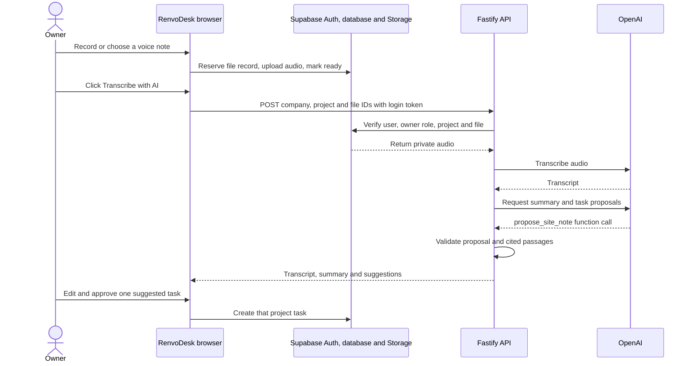

# 029 — AI site-note transcription and task proposals

Date: 2026-09-26. Status: implemented locally behind a disabled-by-default UI flag; production rollout pending.

## Decision

An owner may request analysis of a saved, ready WebM or MP4/M4A voice note from a project’s Documents tab. The Fastify API authenticates the caller with Supabase Auth, checks owner membership and project scope, and downloads the private file using the caller’s token and existing Storage policy. The browser never receives the provider credential.

The server uses `gpt-transcribe` for transcription and forces a `propose_site_note` function call from `gpt-6-luna`. It validates the returned structure and length limits and requires each displayed evidence passage to occur verbatim in the transcript. Invalid task suggestions are omitted and the owner is told when this happens. If the proposal envelope cannot be validated, the owner still receives the transcript with a clear unavailable state for the summary and suggestions. The function call produces a review proposal; the server never executes a task write from model output. The owner sees the transcript and verified suggestions, can edit each task, and explicitly creates tasks through the existing task service. Each suggestion has one request UUID for safe retries.

Analysis results are transient in the page. No database migration, transcript retention, background job, automatic task creation, or customer-facing acceptance is part of this milestone. Ogg attachments remain available for storage but cannot use this transcription route.

## How the workflow works

### 1. Capture and upload

The owner can use **Record voice note** on a saved project's overview, which opens the recorder in **Documents**, or start from **Voice note** in Documents. They can also select an existing supported audio file. The browser asks for microphone access, records at most five minutes, lets the owner listen, and places the recording in the upload form after **Use this file**. Selecting the recording does not upload it. The owner clicks **Upload** separately.

The browser first inserts a `pending` `project_files` row with a stable request ID. It then uploads the bytes to the private `project-files` Storage bucket without overwriting an existing object and changes the row to `ready`. The database checks Storage MIME and size when finalizing. An incomplete transfer remains recoverable as a pending file. The file limit is 10 MiB; existing account and company storage quotas also apply. The original recording remains a private project file even if it is never analyzed.

### 2. Request analysis and authorize access

The **Transcribe with AI** action appears for an owner, when `VITE_AI_SITE_NOTES_ENABLED=true`, beside a ready WebM or MP4/M4A file. The page says that analysis sends the recording to OpenAI. Ogg files may be uploaded and played, but have no analysis action. The browser sends a `POST` request containing company, project and file IDs in the route and the current Supabase access token in the `Authorization` header. It does not send the provider key or audio to OpenAI directly.

Fastify validates the UUID route parameters and bearer header. The API checks the token with Supabase Auth, rejects anonymous users, reads the caller's owner membership, and reads the selected project with both company and project filters. Only then does it look up a matching `ready` file using all three IDs. It checks the generated object key, MIME type and size, downloads the private bytes with the caller's token, and verifies the byte count. The API uses the Supabase publishable key and caller token, so database and Storage RLS remain in force; it has no service-role key. Members can read allowed project files but cannot invoke this owner-only analysis route. The standalone `GET .../ai-context` route is available for future server-side context reads; this analysis request performs its own project check and does not call that route.

### 3. Transcribe and request a proposal

The API makes two sequential provider requests while the browser waits. First, it sends the audio with a generic filename to `gpt-transcribe` and requires a nonempty transcript of at most 15,000 characters. Second, it sends the transcript, the project's name and city, the owner's local calendar day and the first page (up to 50) of company team members to `gpt-6-luna`. Team members are sent as opaque keys (`member_1`, …) labelled with the part of their e-mail before `@`; user IDs and full addresses are not sent. It asks for exactly one `propose_site_note` function call. The second request sets `store: false`; that setting alone is not a complete provider retention or data-residency guarantee.

Here **tool calling** means the model returns structured arguments for a proposal: one summary and up to five task suggestions, each with a title, notes, evidence, an optional assignee key and optional start and due dates. The tool does not write to the task database. The server requires one call with the expected name, validates the output shape and text lengths, and displays only tasks whose cited evidence passage occurs in the transcript. The comparison ignores differences in apostrophe and quote style, spacing, case, Unicode composition and punctuation at the edges; different words still fail. It omits invalid or excess suggestions and signals that omission in the review. A malformed overall proposal yields a transcript-only review with an unavailable notice. The server maps a returned assignee key back to a team member ID and discards unknown keys. It keeps a date only when it is a real `YYYY-MM-DD` day between 1900 and 2100 and discards both dates when the start is after the due date; a discarded field leaves the task visible with that field empty. The instructions ask the model to set an assignee or date only when the note names the person or states the day, resolving relative days against the owner's date, and not to invent prices, measurements, commitments or customer decisions, but these checks cannot prove that a suggested task is a sound interpretation. Human review remains required.

### 4. Review and create tasks

The owner sees the transcript, a read-only proposed summary and editable task titles, assignees, start and due dates, and notes. Suggested assignees and dates are prefilled, and the team list is loaded in the browser so the owner can change or clear them. They click **Create this task** separately for each suggestion they accept. Closing the review while any suggestion is uncreated asks for confirmation, because results are not stored. The AI result alone creates nothing. Each confirmed task uses the existing task service and starts as `todo` with the assignee and dates shown in the form at the time of the click. Normal Supabase task authorization still governs the insert.

Each suggestion has one request UUID. Once a valid save is attempted, its fields are locked in the dialog so a retry sends the same details and ID. If the insert succeeded but its response was lost, the task service reads the existing row on a duplicate ID. A failed task save remains available to retry; other proposals are not saved automatically. The project task views refresh after a confirmed save.

| Data | Current lifetime |
| --- | --- |
| Original audio | Private Supabase Storage object until the owner deletes it through the normal file flow. The database retains a deleted metadata tombstone. |
| Transcript, summary and suggestions | Held in the active browser page only; closing the review or reloading loses them. |
| Confirmed task | Persisted as a normal `project_tasks` row only after the owner's explicit click. |
| OpenAI key | Server environment only; never included in the browser bundle. |

### Failure and retry behavior

Invalid or missing authentication returns 401; a non-owner returns 403. A missing project or ready file returns 404, and unsupported audio returns 415. If no provider key is configured, the API returns `ai_unavailable` with 503. Upstream failures return bounded 503 reason codes without exposing internal details. Invalid proposal content is handled as described above, so a valid transcription remains visible. Repeating **analysis** makes new provider requests and may incur new charges. That is separate from retrying a task insert with its stable request UUID. There is no background job or durable analysis cache.

## Rollout limits

The API remains local only and the UI flag defaults to false. Provider calls can incur charges, including repeated analyses. Before production use, deploy and secure the API route, configure an eligible provider account and data-processing settings, and add durable request deduplication, rate or budget controls, and operational monitoring. Verify the flow with synthetic or consented recordings. This decision does not establish production data residency or privacy compliance.
